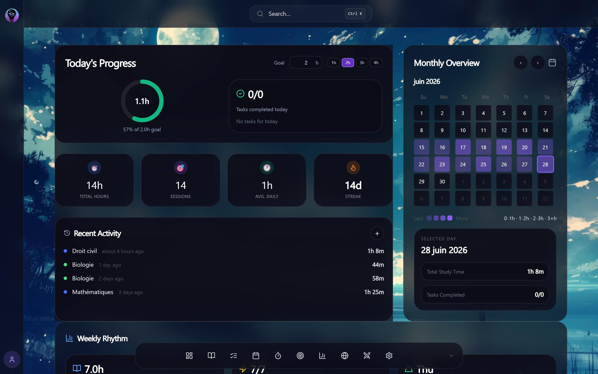
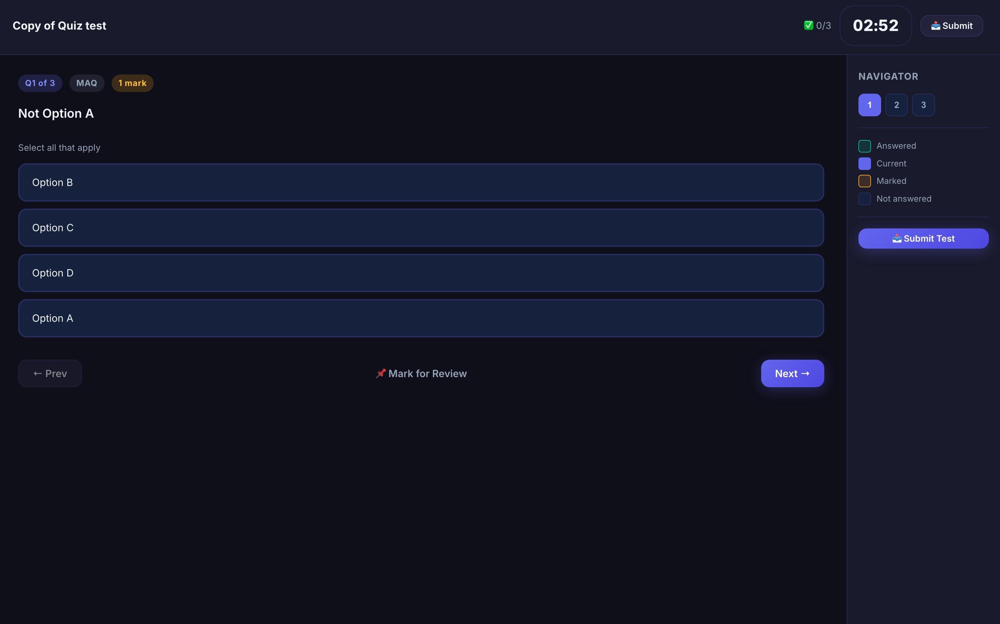
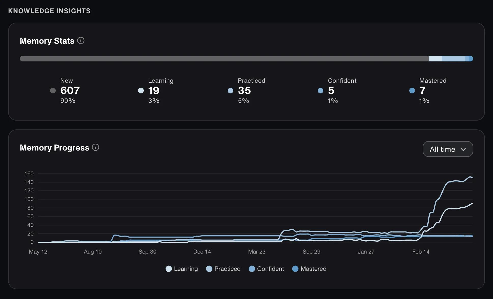

# 👻 GhostLog

### Your past self remembers what your present self forgets.

**A Python-powered learning diary that helps you find, practise, and retain forgotten knowledge.**

<p align="center">
  
  
  
</p>

*Concept mockups — planned features and interface ideas; not screenshots of a working application.*

---

## What is GhostLog?

GhostLog is a personal learning diary and revision companion. It records what you study, creates practice questions from your topics or learning materials, tracks your answers, and schedules revision for knowledge that needs more attention.

The key idea is simple: **users record what they learn; GhostLog handles the revision questions and review history.** Users do not have to write their own quizzes.

> **Project status:** Concept and planning stage. Features in this README describe the intended roadmap, not a completed application.

## How it works

### 1. Record your learning

At the end of a study session, GhostLog asks what you worked on. For example:

- **Course:** Python for Everybody
- **Topics:** Dictionaries, loops, functions
- **Difficulty:** Dictionaries were confusing
- **Confidence:** 3/5
- **Optional material:** Notes, textbook chapters, or course documents

Users can record multiple courses and topics over time.

### 2. Generate questions automatically

GhostLog is planned to support two question-generation modes:

| Feature | Quick Mode | Material Mode |
| --- | --- | --- |
| User input | A topic name | Notes, text, or supported documents |
| Example | Python dictionaries | Your Python course notes |
| Question source | General subject knowledge | Supplied learning material |
| Best for | Quick revision | Course-specific revision |
| Internet required | Depends on implementation | Depends on implementation |

Preferred question format is **multiple-choice (MCQ)**. Other planned formats include:

- Fill-in-the-blank
- Short-answer
- Code-output prediction
- Simple practical problems

GhostLog should label whether a question is based on supplied material or general subject knowledge. Where possible, it should show an explanation and the source passage. AI-generated questions can be wrong, so source-grounded questions and answer checks are important safeguards.

### 3. Test your memory

Each question will offer answer choices plus two special responses:

- **I forgot** — “I studied this, but I cannot recall the answer.”
- **Not learned** — “I have not learned this concept, or I do not recognize it.”

These responses are tracked separately from an ordinary incorrect answer. This helps GhostLog distinguish a recall problem from a topic the learner may never have studied.

### 4. Review what needs attention

GhostLog will use quiz results and review history to schedule the next practice session.

- Correct answers can lead to longer review intervals.
- Incorrect answers can bring a topic back sooner.
- **I forgot** can increase the topic's review priority.
- **Not learned** can flag the concept for clarification instead of treating it as forgotten knowledge.

The initial scheduler will use simple, transparent rules. Review intervals can be improved as the project develops. GhostLog estimates what may need review; it cannot know that a person has forgotten something without testing their recall.

### 5. Track progress

The planned dashboard will summarize:

- Courses and topics recorded
- Reviews due and overdue
- Correct, incorrect, and forgotten responses
- Topics marked as not learned
- Review history and progress over time

## Planned Python architecture

We will begin with a small command-line prototype and split it into modules when the code grows. The structure below is a target design, not a requirement to create every file on day one.

```text
ghostlog/
├── main.py          # Main menu and application flow
├── diary.py         # Daily study entries
├── topics.py        # Courses and topics
├── questions.py     # Question banks and generation
├── quiz.py          # Quiz flow and answer recording
├── scheduler.py     # Review scheduling
├── storage.py       # Saving and loading data
├── reports.py       # Progress and forgotten-topic reports
├── data/            # Local learning records (not committed)
├── docs/
│   └── images/
│       ├── conceptgl1.jpeg
│       ├── conceptgl2.jpeg
│       └── conceptgl3.jpeg
├── .gitignore
└── README.md
```

### Planned technology

- **Python** — application logic
- **JSON** — simple local storage for the first prototype
- **SQLite** — a possible later option for larger collections of topics and review records
- **AI API or a local model** — optional question generation
- **TXT, PDF, and DOCX readers** — added incrementally for Material Mode
- **Desktop notifications** — a later feature; reminders require the app or a scheduled background process to run

The diary, storage, quiz tracking, and scheduling logic can all be built with ordinary Python. An AI service is not required for every part of GhostLog.

## Development roadmap

| Version | Milestone | Planned features |
| --- | --- | --- |
| **0.1 — Memory Diary** | Record learning | Save courses, topics, and daily study entries |
| **0.2 — The Quiz** | Practise recall | MCQs, answer recording, “I forgot,” and “Not learned” |
| **0.3 — Ghost Scheduler** | Revise at the right time | Due reviews, review intervals, difficult-topic priority |
| **0.4 — Material Reader** | Use course resources | Read supported files and create source-grounded questions |
| **0.5 — Ghost Dashboard** | See progress | Statistics, revision history, course/topic progress |
| **1.0 — Complete GhostLog** | Bring it together | Integrated workflow, reminders, error handling, privacy controls |

## Privacy principles

- Keep learning records local in the initial version.
- Do not commit personal notes, course documents, API keys, or private learning data to GitHub.
- Explain clearly if an AI provider receives topic names or learning material.
- Let users inspect, export, edit, and delete their learning history.
- Distinguish generated questions from questions grounded in the user's own material.

## Getting started

GhostLog is currently a project concept. Implementation instructions will be added when the first working prototype is ready.

A sensible first milestone is a small Python program that records a study session, saves it to JSON, and loads it again when the program restarts.

## Contributing and feedback

Ideas, bug reports, and suggestions are welcome as the project takes shape. Please describe the use case and expected behavior clearly.

## License

No license has been selected yet. Until a license is added, the repository should not be assumed to grant permission to reuse or redistribute the code.

---

<div align="center">

**Small steps every day. Big knowledge tomorrow.**

*GhostLog — Your learning history, brought back to life.* 👻

</div>
